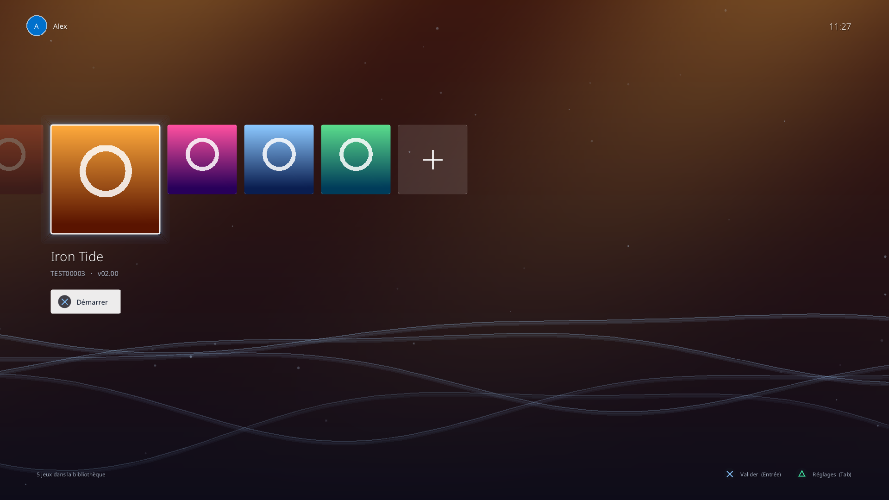

# Lumen

Une interface de console façon PS4 pour lancer ses jeux PS4 sur PC (Windows, Linux, macOS).
Lumen gère la bibliothèque et l'expérience « canapé ». L'émulation est assurée par le cœur
[shadPS4](https://github.com/shadps4-emu/shadPS4), lancé comme programme séparé.



## Objectifs

- **Simple** : on glisse un dossier de jeu dans la fenêtre, l'icône apparaît, ✕ pour jouer.
- **Beau** : écran d'accueil inspiré de la PS4 (tuiles, fond du jeu, vagues lumineuses).
- **Léger** : un exécutable autonome d'environ 5 Mo (C++20, SDL3, Dear ImGui). Il redessine
  l'écran seulement quand quelque chose bouge et se réduit pendant que le jeu tourne. Le fond
  animé peut être désactivé.
- **Manette d'abord** : DualShock, DualSense et Xbox reconnues directement via SDL3. Le clavier
  fonctionne aussi.
- **Sons** : petits sons de navigation (synthétisés, aucun fichier embarqué). La musique du jeu
  sélectionné (`sce_sys/snd0.at9`) démarre après une courte pause sur sa tuile, comme sur PS4.
- **Fiche du jeu** (△) : version, mise à jour installée (`CUSAxxxxx-UPDATE` / `-patch`), mods,
  firmware requis, taille, emplacement.
- **Compatibilité** : statut communautaire de chaque jeu avec shadPS4 (Jouable, En jeu, Menus,
  Démarre, Ne démarre pas), lu dans la base
  [shadps4-game-compatibility](https://github.com/shadps4-compatibility/shadps4-game-compatibility)
  et mis à jour une fois par jour (via `curl`).

## Utilisation

1. Récupérez [shadPS4](https://github.com/shadps4-emu/shadPS4/releases) et placez `shadPS4`
   (ou `shadPS4.exe`) à côté de Lumen. Vous pouvez aussi indiquer son chemin dans les Réglages.
2. Ajoutez vos jeux : glissez un dossier dans la fenêtre, ou utilisez la tuile **+**. Un dossier
   peut être un jeu (`CUSA00001/` contenant `eboot.bin` et `sce_sys/param.sfo`) ou un dossier qui
   en contient plusieurs.
3. Choisissez un jeu et appuyez sur ✕ / Entrée.

| Action | Manette | Clavier |
|---|---|---|
| Naviguer | Croix directionnelle / stick gauche | ← → |
| Démarrer | ✕ | Entrée |
| Fiche du jeu | △ | I |
| Réglages | Options | Tab |
| Retour / forcer l'arrêt du jeu | ○ | Échap |
| Plein écran | | F11 |

Options en ligne de commande : `--boot CUSA00001` lance directement un jeu (pratique pour un
raccourci sur le bureau), `--config-dir <dossier>` utilise un autre dossier de réglages,
`--screenshot <fichier.png>` rend l'interface hors écran et enregistre une capture.

> Lumen ne fournit ni jeux, ni firmware, ni clés. Utilisez uniquement des copies de jeux que
> vous avez extraites vous-même de votre console.

## Compiler

Prérequis : CMake ≥ 3.24, un compilateur C++20 et Git. SDL3, Dear ImGui, stb, nlohmann/json et
LibAtrac9 (décodeur ATRAC9, licence MIT) sont téléchargés automatiquement.

```bash
cmake -S . -B build -G Ninja -DCMAKE_BUILD_TYPE=Release
cmake --build build
```

Sous Linux, installez d'abord les en-têtes X11/Wayland requis par SDL3, par exemple sur
Debian/Ubuntu :

```bash
sudo apt install ninja-build libx11-dev libxext-dev libxrandr-dev libxcursor-dev libxi-dev libxss-dev libxtst-dev libxkbcommon-dev libwayland-dev libegl1-mesa-dev libdbus-1-dev libudev-dev libasound2-dev libpulse-dev libpipewire-0.3-dev
```

Pour tester sans vrai jeu, `tools/make_test_games.py <dossier>` génère des faux dossiers de
jeux (avec icônes et fonds d'écran).

## Organisation du code

| Fichier | Rôle |
|---|---|
| `src/app.*` | Boucle principale, entrées clavier/manette, glisser-déposer, notifications |
| `src/ui/home.*` | Écran d'accueil type PS4 (tuiles, fond, animations) |
| `src/ui/settings_panel.*` | Panneau des réglages |
| `src/ui/game_info.*` | Fiche d'informations du jeu |
| `src/audio.*` | Sons de navigation et musique du jeu |
| `src/at9.*` | Lecture des fichiers ATRAC9 (`snd0.at9`) |
| `src/compat.*` | Base de compatibilité shadPS4 |
| `src/ui/theme.*` | Couleurs, polices, symboles ✕ ○ △ □ |
| `src/library.*` | Recherche des jeux et lecture des métadonnées |
| `src/sfo.*` | Lecteur du format `param.sfo` |
| `src/emulator.*` | Lancement et suivi du processus shadPS4 |
| `src/settings.*` | Réglages enregistrés dans le dossier utilisateur |

## Feuille de route

- [x] Écran d'accueil, bibliothèque, lancement de shadPS4, réglages
- [x] Sons de navigation et musique des jeux (`snd0.at9`)
- [x] Fiche du jeu, mises à jour et mods détectés, statut de compatibilité
- [ ] Prise en charge des archives `.zar` de shadPS4
- [ ] Mise à jour automatique de shadPS4 (la compatibilité progresse à chaque version)
- [ ] Réglages par jeu (résolution, patchs), transmis à shadPS4
- [ ] Retour au menu par le bouton PS pendant le jeu (nécessite une modification du cœur)
- [ ] Paquets d'installation Windows / AppImage / .dmg
